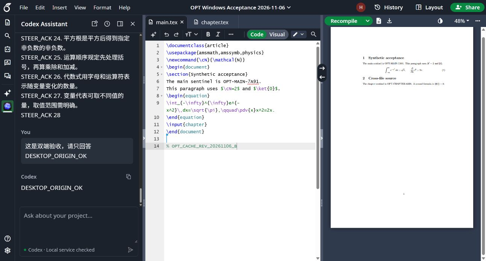
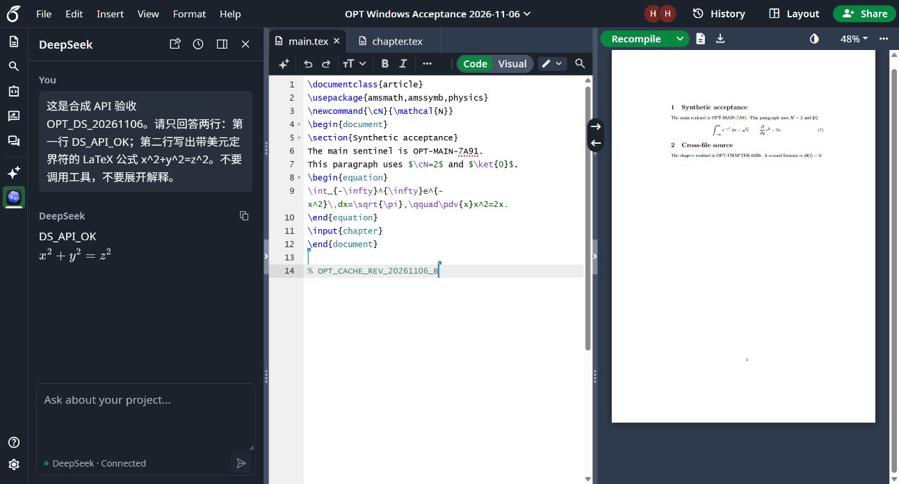
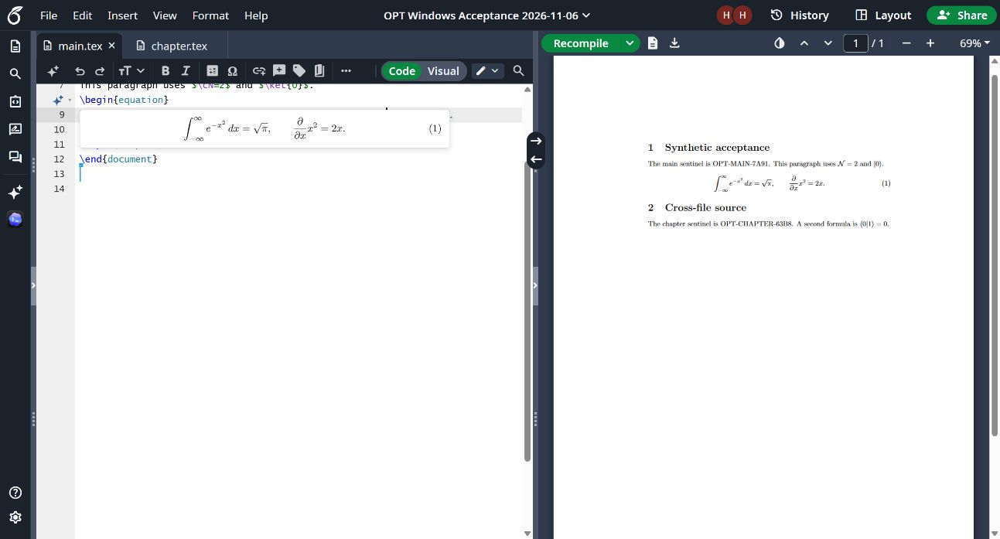

# 2026-11-06 Windows 实测证据

这是维护者在专用合成 Overleaf 项目上的历史验收记录，不是其他用户机器的验收结果。运行时版本为 **0.12.17 Windows development**；本机 TeX 预览截图来自同一轮验收的 0.12.16 阶段，0.12.17 未改 TeX 实现。测试源码只包含两个合成标记和演示公式，未使用原稿，未提交 API 密钥、凭据、聊天数据库或原始诊断日志。

[完整复现、修复、实测与限制](../../../docs/windows-connection-acceptance.md)记载了原始测试过程；[结构化摘要](results.json)区分自动测试、真实网页操作、用户确认和未覆盖项目。新用户应从[安装与验收指南](../../README.md)开始，在自己的机器运行检查。

当前 `acceptance/project/` 是为新用户整理的最小复测项目：保留相同两个合成标记，使用标准宏包和自定义 `\ket`，减少额外安装依赖；已单独用 pdfLaTeX 编译通过。它与这些历史截图中使用 `physics` 宏包的原测试源码不完全相同，也没有被追溯标记为已经完成本轮浏览器验收。

## 可以从图片直接核对的结果

Desktop 发起的 `DESKTOP_ORIGIN_OK` 问题与回答回到 Overleaf 的同一会话；底部状态准确写作 `Local service checked`。这张图片证明最终问答同步，不证明所有桌面生成中的接管分支。

用户配置的真实 DeepSeek API 返回合成标记与数学公式。图片只展示合成问题与回答，不包含连接密钥。

Code 模式显示本机 TeX 渲染的 Gaussian 积分及 `physics` 偏导公式。验收时另核对了实际 TeX 渲染标记和图片加载状态，未把即时 MathJax 草稿计作 TeX 编译成功。

## 结果与边界

0.12.17 前端完整检查为 56 个测试文件、971 项通过，TypeScript 与构建通过；原生 421 项中 406 项通过、15 项按平台或权限条件跳过。最终安装审计的 14 个 Python 副本全部匹配。跳过不计入通过。新增安装/验收脚本的验证在 PR 中单独记录，不回填成这次历史 UI 验收的一部分。

真实页面完成了跨文件读取、刷新恢复、排队与恢复、Steer、停止后的部分回答保留、双端最终问答同步、API 取消、Code/Visual 预览、云端 TeX、项目宏补全与撤销、引用定位和主题/字号切换；公式复制由用户 Ctrl+V 确认。自动清理在最后页面退出约 33 秒后移除 temporary 版本并保留 persistent 版本。用户确认显式清理后缓存变为 0，指定聊天历史及部分回答哈希不变；再同步恢复两文件、487 bytes 的 temporary 版本。

未实测 macOS、完整 Chrome 重启、BFCache 恢复和所有 Desktop writer 交接分支。后台项目绑定已核对，但 Desktop 侧栏自动归类不受当前扩展接口保证；本轮两条测试聊天通过用户/专用工具 Move 后验证归类。旧版已经删除的部分回答没有恢复，0.12.17 仅验证防止新的丢失。

## 新增安装脚本的实际验证

同日另外运行了 `scripts/windows-acceptance.py --setup --workspace <本机已有项目> --local-tex --full`。[脚本生成的脱敏报告](runner-verification.json)记录依赖安装、构建、两个 helper 注册、前端完整检查、421 项原生回归（15 跳过）、24 项 runner 回归（无跳过）、14/14 安装副本及 Codex/TeX 健康检查全部通过。TeX 检查实际在沙盒编译一次合成公式；未向任何模型发出请求。报告故意保持 `overallResult: MANUAL`，这次脚本运行没有重新执行网页验收，也没有将上面的历史 UI 通过结果自动填进去。

另以 `--api-only` 执行只读检查，验证 Codex 健康检查被跳过而整体仍待人工；再故意指定不匹配的已有目录，验证返回 FAIL/退出码 1、不启动本机服务探测。最终错误提示要求先处理 FAIL 再继续人工操作，相关 24 项脚本测试在该提示调整后再次通过。生成 ZIP 的条目严格为 `main.tex` 与 `chapter.tex`，CRC 检查无损坏，内容逐字节匹配提交的合成文件。
