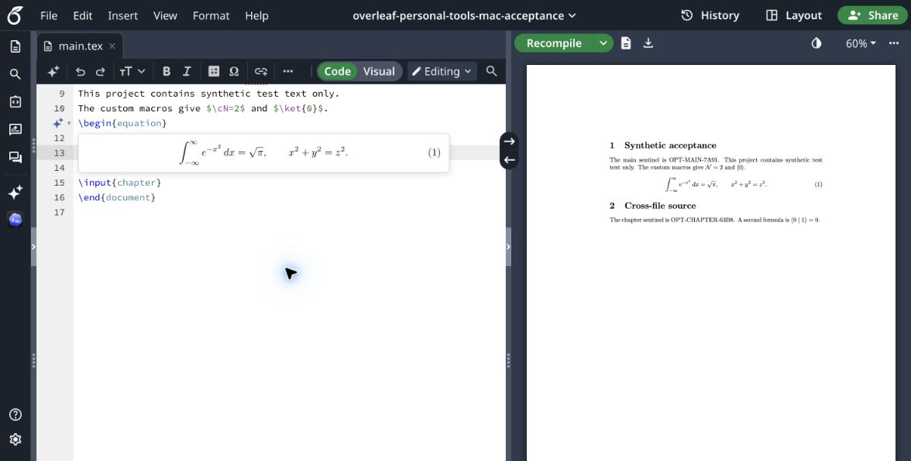

# macOS 0.12.18 验收记录

日期：2026-11-06。对象为合并 Windows [PR #1](https://github.com/FuXihhy/overleaf-personal-tools/pull/1)后的 0.12.18 扩展与配套本机代码。以下区分自动回归和真实 Chrome／Overleaf 操作，未把后台健康检查当作模型推理或桌面实时同步的证据。

本轮使用专用合成 Overleaf 项目，只有 `main.tex`、`chapter.tex` 两份源码和测试公式。没有修改真实稿件。Windows 0.12.17 的既有证据保留在[原验收记录](windows-connection-acceptance.md)；本轮 Mac 结果不表示最终 0.12.18 已在 Windows 重新跑完整矩阵。

## 本轮修复

- **发送时的缓存模式保持一致。** 问题、排队项、引导及缓存修复使用捕获该请求时的保留模式；随后修改项目设置只影响之后的请求，避免异步读取期间把既有请求的临时／保留策略替换掉。主动手动同步期间模式变化会使过时操作退出，避免继续按旧设置上传。
- **Mac 保留镜像路径冲突。** 拒绝大小写及 Unicode 规范等价的文件／目录别名，避免默认 APFS 把两条虚拟项目路径合成一个目录、下次同步误报镜像被编辑。非冲突 Unicode 路径可以重复同步；不通过静默重命名改变源码路径。
- **纯 API 安装。** `native/install_codex.py --install --api-only` 不查找 Codex、不注册 MCP。对应卸载支持纯 API 安装，并拒绝留下已经登记的失效 reader。安装／启动测试使用隔离的临时目录与真实 Native Messaging 帧。
- **Mac 测试路径。** 测试规范化系统临时目录的 `/var` 路径，生产存储继续拒绝调用者路径中的软链接／reparse point，没有通过放宽存储边界换取通过。

PR 中浏览器文档身份、连接状态、停止后部分回答保留与预览状态归属的共享修复一并保留。逐文件背景见[跨平台修复清单](cross-platform-fixes-0.12.17.md)。

## 自动检查

| 检查 | 本机结果 |
| --- | --- |
| TypeScript、前端测试与构建 | 56 个测试文件，976 项通过；类型检查与构建通过 |
| Native 回归 | 共 428 项，392 项通过、36 项平台条件跳过 |
| 安装／验收脚本回归 | 共 24 项，21 项通过、3 项平台条件跳过 |
| 发行包 | 两个 ZIP 的 CRC 与许可证完整性检查通过；源码包全新解压后执行锁定依赖安装及构建通过，46 个非 sourcemap 构建文件逐字节一致 |

跳过项未计入通过。自动测试中的模拟服务、合成项目和临时目录与下方真实网页验收分别记录；测试数量本身不证明所有桌面／浏览器分支均已实测。

## 真实 Chrome 与 Overleaf

| 操作 | 观察结果 |
| --- | --- |
| 加载扩展 | Mac Chrome 实际加载 0.12.18，Overleaf 出现扩展设置及助手入口 |
| 完整项目同步 | 合成项目的两份源码成功同步，界面显示两文件结果 |
| 真实跨文件 Codex 问答 | 模型实际通过项目读取工具读取两份文件，返回 `main.tex: OPT-MAIN-7A91` 与 `chapter.tex: OPT-CHAPTER-63B8` |
| 生成中停止 | 长回答流式显示至约 20 项时点击 Stop，停止后已经接收的内容保留 |
| 刷新后恢复部分回答 | 刷新项目页、重新打开助手，恢复同一会话的部分回答，没有因缺少正式最终答案而清空；未自动重发问题 |
| 本机 TeX 网页交互 | Local connection 显示 sandbox available；选择 TeX → Local 与 pdfLaTeX 后，实际公式浮窗中的编译图像成功显示，未修改源码。返回助手后状态为 Local service checked |

本机 TeX 实际浮窗截图（仅合成项目）：

跨文件问答与停止测试使用真实 Codex 推理，区别于只读连接检查。测试标记与源文件内容一致，未将“模型列表可读”或“同步成功”单独记为问答通过。

## 尚未重新覆盖的范围

本轮没有把以下操作计为 Mac 实页通过：全部 Desktop writer 交接分支、桌面生成中的实时状态与流式回流、桌面侧栏自动项目归类、完整 Chrome 退出重启、BFCache 前进后退恢复，以及全部 API、云端 TeX、主题、复制和缓存清理交互矩阵。已有自动测试或 Windows 历史证据各保留原范围，不替代这些实际操作。

工作目录、backend 项目绑定、最终历史同步和桌面侧栏归类仍须分别判断。旧版本已经丢失的部分回答没有因此恢复。新用户安装后仍应按[安装指南](installation.md)和[合成项目验收步骤](../acceptance/README.md)核对自己将使用的功能。
